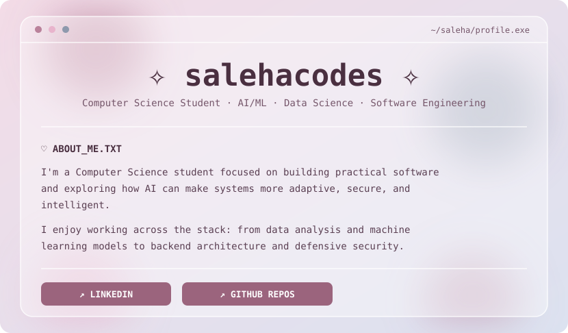
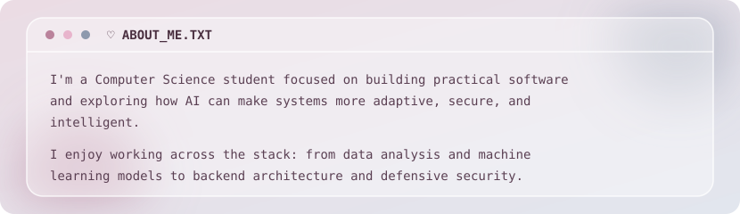

<picture>
  <source media="(prefers-color-scheme: dark)" srcset="assets/banner-dark.svg">
  
</picture>
<picture>
  <source media="(prefers-color-scheme: dark)" srcset="assets/about-dark.svg">
  
</picture>

 

&nbsp;

 

`━━━━━━━━━━ ⋆⋅☆⋅⋆ ━━━━━━━━━━`

<!-- ✦ WINDOW 1: BEEWARE ✦ -->
<table>
  <tr>
    <th align="left" width="680"><code>🐝 BEEWARE.EXE</code></th>
    <th align="right" width="150"><code>—</code> <code>□</code> <code>×</code></th>
  </tr>
  <tr>
    <td colspan="2">
      <b>Adaptive AI-driven cybersecurity honeypot</b> ·   
      An academic capstone investigating how an adaptive honeypot detects, classifies, and engages autonomous agentic AI attacks in real time.  
      <code>♡ Python</code> <code>✦ Cybersecurity</code> <code>✧ AI Agents</code>
    </td>
  </tr>
</table>

 

<!-- ✦ WINDOW 2: GUARDIANHER ✦ -->
<table>
  <tr>
    <th align="left" width="680"><code>♡ GUARDIANHER</code></th>
    <th align="right" width="150"><code>—</code> <code>□</code> <code>×</code></th>
  </tr>
  <tr>
    <td colspan="2">
      <b>Hackathon-winning personal safety app</b> ·   
      A collaborative safety-focused software prototype built under hackathon constraints, featuring rapid alert routing and modular user protection tools.  
      <code>♡ Software Engineering</code> <code>✦ UI/UX</code> <code>✧ Team Build</code> · <a href="https://github.com/salehacodes/GuardianHER"><b><code>[ ↗ VIEW_REPO ]</code></b></a>
    </td>
  </tr>
</table>

 

<!-- ✦ WINDOW 3: WORLD HAPPINESS ANALYSIS ✦ -->
<table width="100%">
  <tr>
    <th align="left" width="680"><code>✧ HAPPINESS_DATA</code></th>
    <th align="right" width="150"><code>—</code> <code>□</code> <code>×</code></th>

  </tr>
  <tr>
    <td colspan="2">
      <b>Exploratory data analysis & visualization</b> ·   
      Statistical exploration of global happiness indicators, uncovering correlations, regional patterns, and multi-year trends across countries.  
      <code>♡ Python</code> <code>✦ Pandas</code> <code>✧ Data Viz</code> · <a href="https://github.com/salehacodes/world-happiness-analysis"><b><code>[ ↗ VIEW_REPO ]</code></b></a>
    </td>
  </tr>
</table>

 

<!-- ✦ WINDOW 4: STUDENT DROPOUT PREDICTION ✦ -->
<table width="100%">
  <tr>
    <th align="left" width="680"><code>⌗ DROPOUT_MODEL</code></th>
    <th align="right" width="150"><code>—</code> <code>□</code> <code>×</code></th>
  </tr>
  <tr>
    <td colspan="2">
      <b>Collaborative machine learning pipeline</b> ·   
      End-to-end classification workflow evaluating academic and demographic features to identify at-risk students early.  
      <code>♡ Python</code> <code>✦ Scikit-Learn</code> <code>✧ ML</code> · <a href="https://github.com/HuzSuddle/CSCI323_Student_Dropout_Prediction"><b><code>[ ↗ VIEW_REPO ]</code></b></a>
    </td>
  </tr>
</table>

 

`━━━━━━━━━━ ⋆⋅☆⋅⋆ ━━━━━━━━━━`

## `⚙` TECH STACK

**Languages**

**Backend & Data**

**Data Science & ML**

**Tools**

 

`━━━━━━━━━━ ⋆⋅☆⋅⋆ ━━━━━━━━━━`

`✧` `♡` `✦` `⌗` `✧`

Thanks for stopping by! Have a lovely day ♡

<!-- ✦ END ✦ -->
